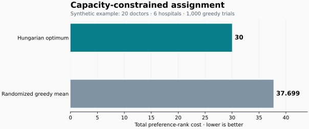

# Biomedical & Digital Health Portfolio

**樊子涵 · Zihan Fan | Johns Hopkins University · Biomedical Engineering M.S.E.**

[English overview](README.en.md) · [GitHub 主页](https://github.com/hallenfan222)

这份作品集展示我如何将生物医学问题转化为分析任务、实现代码、比较方法，并说明结果的适用范围。项目来自课程与团队实践；每个项目都交代本人工作、技术方法、实际进度和局限。

## 项目导航

| 项目 | 要解决的问题 | 展示材料 | 进度 |
| --- | --- | --- | --- |
| **[单细胞药物扰动响应预测](projects/single-cell-perturbation)** | 已知部分药物—细胞组合时，如何预测其他组合的基因差异表达响应？ | 精选模型代码、验证设计、源 Notebook 的结果记录、独立模拟数据演示 | 有本地验证记录；最终测试结果未定 |
| **[医生—医院匹配](projects/doctor-hospital-matching)** | 在医院容量约束下，如何改善医生整体偏好匹配？ | 可直接运行的算法、20 人模拟案例、1,000 次随机贪心对照、最优性测试 | 演示已复现 |
| **[Eye Sentinel：青光眼筛查与人工复核](projects/glaucoma-review)** | 当人工复核资源有限时，应优先复核哪些青光眼筛查样本？ | 问题定义、本人参与、固定 10% 复核预算的评价计划 | Proposal；不宣称完成实验 |

## 建议阅读顺序

- **产品 / 项目岗位：**先看青光眼项目的需求约束和评价计划，再看匹配项目如何量化方案差异。
- **数据 / 技术岗位：**先看单细胞项目的划分方法与模型局限，再运行两个演示和测试。

## 快速运行

匹配演示只使用 Python 标准库。完整演示环境已在 Python 3.12 验证。

```bash
git clone https://github.com/hallenfan222/biomedical-portfolio.git
cd biomedical-portfolio
python projects/doctor-hospital-matching/assignment.py

python -m venv .venv
# macOS / Linux
source .venv/bin/activate
# Windows PowerShell: .venv\Scripts\Activate.ps1
python -m pip install -r requirements.txt
python projects/single-cell-perturbation/demo.py
python -m unittest discover -s tests -v
```

两个演示均不需要下载原始研究数据或输入凭据。单细胞演示的合成分数只用于检查运行流程，不能解释为真实生物学预测性能。

## 可核查的结果

医生—医院模拟案例中，Hungarian 分配的总偏好成本为 **30**，1,000 次随机贪心的平均成本为 **37.699**；前者在这个固定案例上较后者均值低约 **20.4%**。这一比较针对模拟偏好和特定目标函数，不代表真实招聘或医疗服务收益。



单细胞项目的数值单独标为“源 Notebook 保存的本地验证记录”，并交代四折稀疏细胞验证的含义。没有把保存的输出当作本次全量重跑结果，也没有把计划写成已实现效果。

## 范围与来源

本仓库是单独整理的展示副本。原课程 / 研究仓库及其历史保持原样；没有迁移私有课程资料、原始数据、大体积预测文件、缓存或神经电生理受限材料。

- [文件来源与整理记录](PROVENANCE.md)
- [运行验证记录](VALIDATION.md)
- 每个项目 README：问题 → 本人贡献 → 方法 → 结果 / 计划 → 局限

本仓库用于作品展示，未替上游材料授予新的开源许可。数据和原始课程材料的使用条件仍由各自权利方决定。
