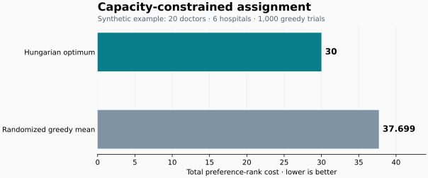

# 医生—医院匹配与容量分配

**Doctor–hospital assignment | Python · Hungarian algorithm · Capacity constraints**

[返回作品集](../../README.md) · [可运行代码](assignment.py)

## 做了什么

在医生对医院有完整偏好排序、每家医院有固定接收容量的条件下，构建分配模型。目标是让所有医生得到一个岗位，并尽量降低整体偏好排名之和。

这是 Biomedical Data Design 课程背景下的算法演示。案例中的 D1–D20、H1–H6 均为模拟标识，不涉及真实医生、医院或人事数据。

## 本人工作与展示范围

本项目以我在 BDD 仓库中提交的 `Rank_Order_total.ipynb` 为来源，展示偏好成本建模、容量槽位展开、Hungarian 求解、随机贪心对照及结果汇总。可追溯至 [该文件的提交记录](https://github.com/hallenfan222/Biomedical-Data-Design/commits/main/Rank_Order_total.ipynb)。

本次作品集整理把已有 Notebook 代码抽取为独立 Python 文件，保留原模拟输入与算法逻辑，补充可运行说明、结果图和测试。整理工作不等同于新增研究成果；也不将标准 Hungarian 算法表述为个人原创算法。

## 怎么做

1. **定义约束：**每位医生恰好分配一次；各医院实际接收人数不能超过容量。输入检查排除偏好重复、未知医院、负容量和总容量不足。
2. **构造代价：**偏好第 1 名的代价为 1，第 2 名为 2，依此类推。将医院容量展开成独立槽位，形成“医生 × 槽位”成本矩阵。
3. **求解与比较：**使用 Hungarian 算法最小化总代价；以随机医生顺序的贪心分配作为对照，固定 `seed=10`，重复 1,000 次。
4. **解释结果：**同时报告总代价、平均匹配排名、第一志愿比例、前三志愿比例和最差排名，避免只看一个平均数。

## 结果如何

以下结果由展示代码重新运行得到，与源 Notebook 的保存输出一致。

| 指标 | Hungarian 分配 | 随机贪心，1,000 次均值 |
| --- | ---: | ---: |
| 总偏好成本，越低越好 | 30 | 37.699 |
| 平均匹配排名 | 1.500 | 1.88495 |
| 第一志愿比例 | 55.0% | 50.905% |
| 前三志愿比例 | 100.0% | 91.215% |
| 最差匹配排名 / 各次最差排名的均值 | 3 | 4.893 |

随机贪心的总代价范围为 **30–50**。Hungarian 的成本相对随机贪心均值低约 **20.4%**；有些贪心顺序同样达到 30，因此这里不是“每次都改善 20.4%”。



## 运行

从仓库根目录执行，无需第三方依赖：

```bash
python projects/doctor-hospital-matching/assignment.py
```

程序打印每位医生的分配和两种方法的评价指标。可修改 `assignment.py` 顶部的 `capacities` 与 `preferences` 进行其他模拟。

## 局限与下一步

- 这是**单侧偏好、总排名成本最小化**。未建模医院偏好，不保证双边稳定匹配，也不是实际住院医匹配系统。
- 总成本最优不等于个体公平最优；最优解可能不唯一。第一志愿比例不是求解器直接优化的目标。
- 当前假设每位医生对所有医院都有严格完整排序，且总容量足够。真实资格约束、拒绝匹配、地区要求等尚未加入。

**English summary.** A reproducible synthetic allocation example turns hospital capacities into assignment slots and minimizes total doctor preference rank. The optimal cost is 30, versus a mean of 37.699 across 1,000 randomized greedy trials. This is a one-sided optimization model, not a two-sided stable matching system or an operational hiring tool.
